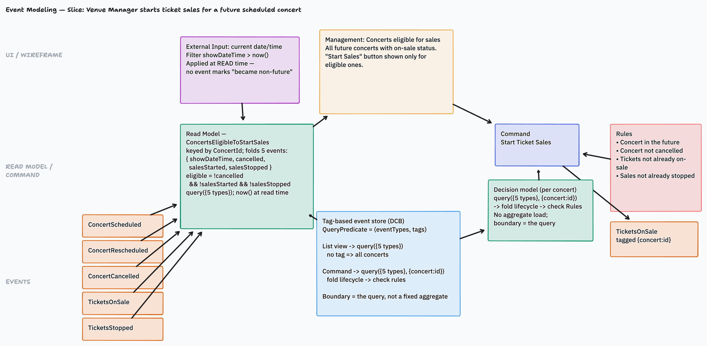

# Workshop: Reading Models in Event Sourcing — Aggregate vs. Query



A worked example built around one event-modeling slice:

> **Venue Manager starts ticket sales for a future scheduled concert.**

Read model of interest: concerts that are **in the future**, **not cancelled**, and
where sales have **not already started** (nor been stopped).

- Events involved: `ConcertScheduled`, `ConcertRescheduled`, `ConcertCancelled`,
  `TicketsOnSale`, `TicketSalesStopped`
- External input: current date/time (to filter out non-future concerts)
- Command: **Start Ticket Sales**
- Rules: concert in the future; not cancelled; tickets not already on-sale; sales not
  already stopped

> **What's already modeled vs. what this workshop builds.** JitterTicket starts the
> workshop with a working event-sourced model; the slices below *extend* it. To keep the
> two straight, everything named in this document falls into one of two buckets:
>
> - **Already in the model** (the baseline you start from): the events
>   `ConcertScheduled`, `ConcertRescheduled`, `TicketsSold`, `TicketSalesStopped`, and
>   `TicketsPurchased`; the event-store `StoredEvent` / `Envelope` wrapper; the
>   `ConcertStartedProcessor` / `SoldOutProcessor`; and the maintained, checkpointed
>   projection machinery (`NewProjectionCoordinator`).
> - **Introduced by the workshop** (proposed, *not* in the baseline code):
>   - *First lab* — the **Start Ticket Sales** command, its `TicketsOnSale` event, and
>     the `ConcertsEligibleToStartSales` **read model** that feeds the "Start Sales"
>     screen (§1–§2).
>   - *Later slices* — `ConcertCancelled`; `TicketsRefunded` with the **Request Refund**
>     / **Refund Tickets** commands (§9); the time-driven `ConcertCompleted` (§5); and
>     the cancellation-refund `RefundProcessor` / `Reconciler` (§10).
>
> So when a section reasons about one of these as if it exists — `TicketsOnSale` in §1,
> `ConcertCancelled` in §5 and §10 — read it as *"once we've added it in this exercise."*
> §9a's reminder that `ConcertCancelled` isn't in the baseline is just this rule stated
> locally.

> **Pre-workshop prep (note to self).**
>
> **Must be BUILT before the workshop** (not in the code today):
> - `StoredEvent` / `Envelope` wrapper — **and it must carry `commandId`** for
>   idempotency (leaned on in §7.6 and §10 Trap 1). Without `commandId` those sections
>   don't ground.
>
> **Already in the code** — just verify still present on the pre-workshop branch:
> - Events: `ConcertScheduled`, `ConcertRescheduled`, `TicketsSold`, `TicketSalesStopped`,
>   `TicketsPurchased`
> - Processors: `ConcertStartedProcessor`, `SoldOutProcessor`
> - Projection machinery: `NewProjectionCoordinator` (maintained + checkpointed)
>
> **Deliberately NOT built pre-workshop** (they are the exercises):
> - *Lab 1:* `TicketsOnSale` event + Start Ticket Sales command + `ConcertsEligibleToStartSales` read model
> - *Later:* `ConcertCancelled`; `TicketsRefunded` + Request/Refund commands;
>   `ConcertCompleted`; `RefundProcessor` / `Reconciler` / time-driven audit

---

## 1. Can we ask the event store for "only future, eligible concerts"?

No — not cheaply, and this is **CQRS by design, not a defect of event sourcing**.

An event log gives you a small number of cheap filter dimensions:

- by aggregate id (per-stream replay)
- by event type
- by event sequence / checkpoint

But the predicate we actually want — *future, not cancelled, sales not started* — is
**derived state**, not a property of any single event:

- **"future"** depends on `showDateTime`, which lives *inside* the payload of
  `ConcertScheduled` / `ConcertRescheduled`, and can be overwritten by a later
  `ConcertRescheduled`.
- **"not cancelled / not on-sale / not stopped"** depends on the *presence or absence of
  later events* in that stream — i.e. on the fold, not on any one row.

There is no indexed way to ask the log "give me the aggregates whose folded state
satisfies predicate P" without either indexing into the payload or maintaining a read
model. Efficiently querying derived state **is the read model's job**. Folding the whole
log at query time is exactly the anti-pattern to avoid.

Corollary that survives every store choice: **"future" is a read-time filter.** No event
marks the moment a concert stops being in the future — the clock does. So the read model
stores `showDateTime` and the query applies `showDateTime > now()` at read time.

---

## 2. The old store: aggregate-oriented (jitterticket)

Events are stored per aggregate (`aggregate_root_id`) with a global `event_sequence`.
Two read shapes:

- **Reconstruct one aggregate:** `eventsForAggregate(id)` → fold the whole stream.
- **Feed a projection:** `allEventsAfter(checkpoint, eventTypes)` → type-filtered catch-up,
  then live subscription.

**Command side.** To decide *Start Ticket Sales* for concert X you **load the `Concert`
aggregate by id** and fold its entire stream, then check the rules and append.

**List side.** The eligible-concerts view is a maintained projection
(`ConcertsEligibleToStartSales`, keyed by `ConcertId`), fed by the type-filtered
catch-up + subscription. Query applies `now()` at read time.

Read strategy for freshness (bounded staleness — already the shape of
`NewProjectionCoordinator`):

1. Load the persisted projection + its `Checkpoint`.
2. Fold `allEventsAfter(checkpoint, {5 types})` on top (idempotent upsert by `ConcertId`).
3. Filter `showDateTime > now()`.

Never folds the full log; the tail is bounded by projection lag. (Production caveat —
sequence holes from out-of-commit-order sequences — is out of scope for the workshop.)

---

## 3. The new store: query-oriented / DCB (tdd-game)

Every event carries a `Set<Tag>` (e.g. `concert:989-ZZX`, `cust:123-ABC`). You read with:

```java
record QueryPredicate(Set<Class<? extends Event>> eventTypes, Set<Tag> tags) {}

List<StoredEvent> query(QueryPredicate queryPredicate);
```

Semantics: return events **whose type is in `eventTypes`** and **whose tags contain all
of `tags`**. There is no `aggregate_root_id` and no fixed aggregate boundary — this is a
**Dynamic Consistency Boundary (DCB)**.

**Command side — the big change.** Instead of loading an aggregate, build a
**just-in-time decision model** scoped by tag:

```
query( {ConcertScheduled, ConcertRescheduled, ConcertCancelled,
        TicketsOnSale, TicketSalesStopped},  {concert:X} )
   → fold → check Rules → append TicketsOnSale tagged {concert:X}
```

Both dimensions push down (types **and** the concert tag); you get exactly that concert's
lifecycle, and **there is no aggregate to load**. The **consistency boundary is the query
itself**, not a fixed aggregate — so a decision spanning concert *and* venue is one query
with two tags, which the fixed-aggregate store can't express without multiple loads.

**List side — barely changes.** "All future eligible concerts" is cross-concert, and tags
don't help: query `{5 types}` with *no* tag (all concerts) and fold into a projection.
Crucially, **tags encode facts at append time, not derived state** — no tag can mean
"currently eligible," because eligibility depends on later events and on `now()`. So you
still maintain a projection, and `now()` is still a read-time filter.

---

## 4. Aggregate vs. Query — side by side

| Concern                 | Aggregate store (old)                          | Query / DCB store (new)                                      |
|-------------------------|------------------------------------------------|-------------------------------------------------------------|
| Read shape for a decision | Load aggregate by id, fold whole stream       | `query(types, {concert:id})`, fold the result               |
| Consistency boundary    | Fixed aggregate (`Concert`)                    | The query predicate — dynamic                               |
| Multi-entity decision   | Multiple aggregate loads                       | One query, multiple tags                                    |
| Optimistic concurrency  | Aggregate version                              | "No new events matching this query since seq N"             |
| Filter dimensions       | aggregate id, event type, sequence             | event type + tags (+ sequence)                              |
| Emitted event           | Belongs to an aggregate stream                 | Carries tags (`{concert:id}`) so future queries find it     |
| List/read-model view    | Projection + `now()` at read time              | **Same** — projection + `now()` at read time                |

---

## 5. Reducing "loaded then thrown away" — turning time into an event

Folding events for concerts that turn out to be **in the past** feels wasteful. The root
cause: **no actor emits an event when a concert becomes past** — the wall clock crosses
`showDateTime` and nothing notices. That's why "future" is stuck as a read-time `now()`
filter. So the real question is: *can we manufacture the event that time refuses to emit?*

**Yes — a time-driven `ConcertCompleted`.** Introduce `ConcertCompleted` (or
`ShowEnded` / `ConcertArchived`), emitted by a **time-based process manager / ticker**
that fires once the *current* `showDateTime` (after any reschedule) passes. This is a
standard ES pattern: a scheduler turns the passage of time into an explicit fact.

- ✅ The projection can **evict** the concert when it handles `ConcertCompleted`, so the
  eligible-concerts read model stays **bounded** instead of accumulating every concert ever.
- ✅ Gives downstream triggers (settlement, reporting, archiving) and domain clarity.
- ❌ Does **not** make the raw store queryable for "future" — it's just another event type.
- ❌ On its own doesn't cut catch-up work — a cold projection still reads every historical
  `ConcertScheduled` (that's what snapshots are for).

**But check whether the waste is even real.** With a **maintained + snapshotted
projection** (exactly what `NewProjectionCoordinator` is: `loadProjector()` restores state
*and* its `Checkpoint`, then `allEventsAfter(checkpoint, types)` tails only *new* events),
you never re-fold the past on the steady-state path, and cold start resumes from the
snapshot. The only per-read cost is a `now()` scan over already-reduced state — cheap. The
"load and throw away" waste is really the signature of the **fold-the-whole-log-at-query-time**
approach; the fix is the projection, and `ConcertCompleted` is then a *nice-to-have* for
eviction, not the thing that saves the folds.

On the **DCB / command side there's no waste at all**: `query({types}, {concert:id})`
loads exactly one concert's lifecycle — past concerts are never touched.

**Other ideas:**

- **Projection eviction without a new event** — lazily skip past concerts at read *and*
  periodically sweep them from the projection map. Simpler than a ticker; loses the audit
  trail / downstream trigger a real `ConcertCompleted` gives you.
- **Time-bucket tags (DCB only)** — tag `ConcertScheduled` / `ConcertRescheduled` with a
  coarse bucket (`show-month:2026-08`) so a query can exclude clearly-past buckets. Caveat:
  a reschedule appends a new event with a new bucket tag (latest wins), and you re-check
  `now()` anyway — so this only trims obviously-stale ranges.
- **Snapshots / stream archiving** — persisted projection snapshots kill cold-start
  refolds; moving concluded concerts' events to cold storage keeps the hot log small.

**Bottom line:** `ConcertCompleted` is the ES-idiomatic move (add it for eviction, clarity,
and downstream triggers), but the efficiency win comes from the *snapshotted projection*,
not from a store-level query trick. `now()` never fully goes away.

---

## 6. Projection-time vs. query-time filtering

Read models are usually tailored to a single UI — yet the UI still often filters (e.g.
dropping past concerts because there's no `ConcertCompleted`). Is that a smell, or a
missing event? Split "filtering" into two kinds that look identical in code but mean
opposite things.

**1. Filtering on stored facts / derived state.** If the UI filters on something the
projection *could have known when it processed the events* — status, category, "has at
least one ticket sold" — that **is** a smell. The projection isn't actually tailored to the
screen; a general-purpose read model is being narrowed at the edge. Fix: push the predicate
into the projection (or build a more specific one). The fact was already there — no new
event needed.

**2. Filtering on read-time inputs.** Some parameters only exist *at the moment of the
request*. **These are always I/O** — the read side reaches out to the world to get them:
the clock (`now()`), a remote API call, the current authenticated user / tenant, requested
page, search text, an "as of" time-travel point. A projection **cannot** bake these in,
because they aren't known when events are processed — and being I/O, they can differ on
every read. Filtering on them is not a smell; it's normal query parameterization.
"One projection per UI" constrains the projection's *shape and content* (which fields,
pre-joined, pre-sorted), not the number of runtime I/O parameters. `now() > showDateTime`
lives squarely here.

**Does the `now()` filter mean a missing `ConcertCompleted`?** Sometimes — the tell is a
threshold vs. a relationship. The clock is a *continuous* variable and events are
*discrete*, so you can never have an event "for every instant of pastness" — that's a
genuine read-time relationship, not a missing fact. But the *crossing* from future to past
is a discrete transition you *could* reify. Whether you should hinges on one question:

> **Does anything in the domain happen at that transition — or does only this one screen care?**

- Other consumers / the write model care (settlement, no-more-refunds, reporting) → the
  transition is a real domain event that's currently **implicit**. Reify it (see §5); the
  filter was a symptom.
- Only this view wants it → inventing an event to delete a `.filter()` couples your event
  log to a UI. Leave it as a read-time filter.

**Litmus tests:**

1. *Is what I'm filtering on a fact that was true at some past instant, or a relationship to
   the present request?* Fact → belongs in the projection. Relationship to `now()` / user /
   page (I/O) → legitimate query parameter.
2. *Would any other consumer, or the write model, want to know about this transition?*
   Yes → missing event, make it explicit. Only this screen → read-time filtering, keep it in
   the query.

So the recurring `now()` filter is **not** a missing-event smell by itself — it's the
discrete/continuous impedance mismatch, and `now()` is I/O. A filter on *stored state*,
however, almost always is a smell: wrong projection or a missing fact.

---

## 7. Slice implementation checklist (command slice)

A checklist for implementing a new slice around a command. Ordered along the decision loop:
**Command → query the decision context → apply rules with I/O inputs → append event →
update read models.**

1. **Command** — name, fields, and **actor / authorization**. Who may issue it, and what
   does it carry? (Its fields usually seed the event's properties.)
2. **Decision Context Queries** — the `QueryPredicate`(s) (event types + tags) that build
   the just-in-time decision model for this command.
3. **Decision Inputs (I/O-based)** — read-time I/O the decision needs: `now()`, remote API
   calls, current user/tenant. (See §6 — these are always I/O.)
4. **Decision (Domain) Rules** — the invariants checked before appending.
5. **Consistency boundary / append condition** — the correctness heart in a DCB store: the
   append must be conditional on *"no new events matching this query since sequence N."*
   Which query guards this command? Without it, two concurrent commands can both pass the
   rules and both append. Pairs directly with the Decision Context Queries.
6. **Idempotency** — retried commands. `StoredEvent` carries a `commandId`; decide whether a
   duplicate `commandId` is de-duped so a retry doesn't double-emit.
7. **Event(s) emitted** — name, properties, and **tags (IDs)** — chosen forward-looking:
   *which later slices need to find this event?* so the tag set is deliberate, not incidental.
8. **Read Models affected** — which projections this event updates or requires.
9. **UI trigger & affordance** — the wireframe/view that *issues* the command, and its
   enable/disable rule (e.g., show "Start Sales" only for eligible concerts). That affordance
   rule usually mirrors the Domain Rules — keep them in sync (UI guards for UX, rules guard
   for truth).
10. **Downstream reactions / side effects** — process managers, notifications, or integration
    events triggered by the emitted event; and whether a *time-driven* companion is needed
    (§5, e.g. `ConcertCompleted`).
11. **GWTs** — Given/When/Then tests covering **both** the happy path **and** rejection paths
    (each rule failing, and idempotent retry).

---

## 8. Takeaways

1. **Querying derived state efficiently is the read model's job** — in *both* store styles.
   The event log is not a query engine.
2. **"future" is always a read-time `now()` filter** — no event marks the transition
   *unless you reify it* (§5's `ConcertCompleted`), and even then `now()` never fully
   goes away.
3. **The store style changes the *command* side, not the *list* side.** DCB replaces
   "load aggregate by id" with "`query(types, {concert:id})` decision model" — no aggregate
   load, and the consistency boundary becomes the query.
4. **Tags are append-time facts, not derived state.** They scope *which* events you fetch;
   they don't tell you whether an entity currently satisfies a rule.

---

## 9. A second slice: *Customer Requests Ticket Refund* — joining a large fact to a small dimension

A different slice, chosen because it stresses a part the first one didn't: a read model
that must **join two streams** at very different scales.

> **Customer requests a refund for a ticket order they hold.**

### 9a. What are the rules?

Starting rules on the table: **concert ≥ 1 week in the future**, **concert not cancelled**.
Those are both about the *Concert*. The gap is everything about the *order* and the *actor*:

- **Order exists** — you can't refund an order that was never purchased.
- **Order belongs to this customer** — implicit when the command targets the `Customer`
  aggregate (the order lives in *their* map), but state it so it survives a refactor.
- **Not already refunded** — the idempotency / double-spend rule. Needs a
  `TicketsRefunded` event so the state is even recordable; without it a refund can fire
  twice.
- **Partial vs. full** — if partial refunds exist, `refundQty ≤ purchasedQty`. Decide
  consciously even if the answer is "full only."
- **"Not cancelled" — is cancellation even modeled?** The only concert-off event today is
  `TicketSalesStopped` (sold out / show started). There's no `ConcertCancelled`. And note the
  direction: a *cancelled* concert should probably **force** a refund, not block one.
- **Reschedule interacts with the window** — the 1-week check must read the *current*
  `showDateTime`, so a reschedule can legitimately reopen (or close) the refund window.

**Workshop framing:** the rules split by aggregate — *order exists / mine / not refunded* are
**Customer** invariants; *1 week out / not cancelled* are **Concert** invariants. So the
decision is inherently **cross-aggregate** (or, in DCB terms, one query with two tags:
`{cust:C}` and `{concert:X}`).

### 9b. The read model: "tickets eligible to be refunded, for this customer"

Simplifying assumptions for the exercise: **no partial refunds**; the customer picks from a
list that already guarantees *own / exist / not-refunded*; **ignore cancellation**. What's
left as the hard part is the **1-week-in-the-future** rule, because it's a **join**:

> non-refunded orders the customer owns (key: `customerId`) → derive the distinct
> `concertId`s → fetch those concerts' folded `showDateTime` → filter `> now + 1 week`.

Two things make this interesting: it's a **moving predicate** (the clock, not any event,
decides eligibility — §2/§6 all over again), and it **joins a large fact to a small
dimension**.

### 9c. Where should the join live? Four options

The scales matter: **~millions** of ticket sales, **~hundreds of thousands** of customers,
**~hundreds** of concerts, and **only a small % of customers ever open the refund page.**

| Option | Where join happens | Rows maintained | Write amplification | Cost paid by | Notes |
|---|---|---|---|---|---|
| **A. Global "refundable ticket" projection** | precompute (write time) | ~millions (row per ticket) | every purchase **and** reschedule fans out | all writes | Wrong at this scale: materializes the path almost nobody reads; needs the deadline/alarm trick for the moving predicate. |
| **B. On-demand per customer** | read time | 0 | none | only visitors | Reconstitute `Customer` (tens of events) → its orders + refunded state; look up the few `concertId`s' dates; filter `now`. Scales with *per-customer* size, not total sales. |
| **C. Denormalize date onto the purchase event** | write time, on the *fact* | 0 extra | reschedule only (rare) | rare reschedules | `TicketsPurchased` carries `showDateTime`; refund page is a single `Customer` load. Owe a process manager: `ConcertRescheduled` → fan out `TicketOrderConcertRescheduled` to that concert's holders. |
| **D. Resident small dimension** | read time, but no round trip | ~hundreds (concerts) | none new | visitors | Same as B, but keep `concertId → showDateTime` **in memory** (it's hundreds of rows, slow-changing). The "second query" becomes a hashmap `get`. |

**The moving predicate, per option.** A must convert "1 week out" into a stored **deadline**
(`showDateTime − 1 week`) or an **alarm** that flips rows — reusing the exact
`ConcertStartedProcessor` scheduling pattern (it already arms a `ScheduledFuture` at
`showDateTime` to `stopTicketSales`; here you'd arm at `showDateTime − 1 week`). B/C/D just
compare against `now()` at read — correct for free.

### 9d. Where it landed

- The **global projection (A)** is the instinctive "build a read model" move and it's the
  wrong one here: it puts join cost on **every** purchase (millions) to serve a page a
  fraction of customers open. The read-model-per-thing pattern earns its keep when reads are
  *frequent* and the source is *expensive on demand*; this is the opposite.
- **On-demand (B)** is fast and cheap because the query is **already scoped to one customer**,
  and both sides are small *for one customer* (tens of orders × tens of concerts). The
  Customer aggregate is the source of truth for own/exist/refunded — **no read model needed
  there at all.** Don't reconstitute the *Concert* aggregates (a popular one has thousands of
  `TicketsSold` events); use a lightweight `concertId → showDateTime` lookup.
- The dissatisfaction with B — *"two separate queries for one screen"* — resolves two ways:
  - **D:** the concert side is a **small, slow-changing dimension**; keep it **resident in
    memory** and the second "query" is a nanosecond map lookup, not a round trip. Removes the
    disappointment with **no new events and no coupling**.
  - **C:** copy the date onto the fact at purchase so the refund decision depends on **nothing
    but the Customer aggregate** — one store access — at the price of a reschedule fan-out
    process manager. Moves the join off the millions-path (purchases) onto the rare-path
    (reschedules), the exact inverse of A.

**Recommendation:** **D** (B + resident dimension) unless you specifically want the refund
decision self-contained in one aggregate, in which case **C**.

**Principle worth stating out loud:** a join between a **large fact** (millions of tickets)
and a **small, slow-changing dimension** (hundreds of concerts) almost never wants the
dimension *materialized into* the fact. Keep the dimension **resident and look it up**, or
**copy it onto the fact at write time and maintain it on the rare change**. Materializing the
whole join (A) is the one option that pays on every write — which is why it feels wrong at
scale.

**Mini-takeaways:**

1. **Match where the join lives to the read/write ratio.** Rare reads + cheap on-demand query
   → don't precompute.
2. **"Two queries" isn't automatically a smell** — a small resident dimension makes the second
   one free.
3. **The aggregate is often already the read model you need** — partitioned by its id, holding
   exactly the state (own / exist / refunded) the query wants.
4. **Same `now()` lesson as §2/§6:** the 1-week rule is a moving, read-time predicate; only
   option A has to reify it (deadline or alarm).

---

## 10. The cancellation-refund automation (Processor) — and how it can bite

The proposed pattern for concert-cancelled refunds:

```
ConcertCancelled  (Concert aggregate)
      │
      ▼
  Processor builds a "Refund List"           ← read model: orders to refund for concert X
      │                                          (holders = TicketsPurchased − TicketsRefunded, tag {concert:X})
      ▼
  Processor issues RefundTickets commands     ← one per order
      │
      ▼
  TicketsRefunded { reason }  (Customer)      ← reason ∈ { CustomerRequest, ConcertCancelled, … }
```

This is the **idiomatic ES automation**: an event triggers a **process manager**, which turns
one fact (`ConcertCancelled`) into many commands (`RefundTickets`), each producing its own
fact. It keeps the `Concert` ignorant of `Customer` internals (it just announces the
cancellation), and one `TicketsRefunded` event with a `reason` keeps the "is this order
refunded?" answer single-sourced while preserving provenance. It's a good default. Here's
**how it can go wrong** — grouped by the three traps that actually bite.

### Trap 1 — treating the list/Processor as the correctness boundary

The Refund List and the Processor are an **optimization**, not the invariant. Processors run
**at-least-once**: a crash or replay mid-fan-out will re-issue `RefundTickets`. So:

- **Correctness must live in the command guard**, not in "we processed the list once." The
  `Customer`'s *not-already-refunded* guard (§9a) is what actually prevents double refunds;
  plus `commandId` idempotency (§7.6) so a retried command doesn't double-emit. If anyone
  leans on the list being consumed exactly once, that's a latent double-refund bug.
- **Race with customer-initiated refunds.** A holder refunds *themselves* between list-build
  and list-processing; the Processor then hits an **already-refunded** order. The guard must
  reject it and the Processor must treat that rejection as **success/skip**, not a retryable
  error — otherwise a retry storm. (Same guard, now serializing a customer refund against the
  cancellation fan-out.)
- **Ordering with sales.** `ConcertCancelled` must stop sales *before or atomically with* the
  list being built, or a purchase sneaks in after the snapshot and is **silently never
  refunded**. This is cleanly closed by a **write-side guard**: `PurchaseTickets` appends
  `TicketsSold` *conditional on the concert boundary* — reject if any new concert event
  (including `ConcertCancelled`) has arrived since the sequence it read. Then cancellation and
  purchase are serialized on that boundary: once `ConcertCancelled` commits, no `TicketsSold`
  can ever follow it, so when the Processor builds the list *after* observing the cancellation,
  the set of `TicketsPurchased` for X is **complete and final** — there is no snapshot window at
  all. (This is a real conditional append, not a read-then-write with a gap. Given it, the
  "late buyer" hole is gone — and with it the *completeness* argument for reconciliation below.)

### Trap 2 — the fan-out is an operational event, not a loop

- **Thundering herd.** A sold-out arena is *tens of thousands* of `RefundTickets` commands in
  a burst, each likely touching a **payment gateway**. A naive `for order in list: issue()`
  hammers the store and the gateway. You need **batching / throttling / backpressure**, and a
  **checkpoint/cursor** so a Processor restart resumes mid-run instead of restarting the burst.
- **No batch atomicity, no completion signal.** `ConcertCancelled` is one fact; the N refunds
  are N independent transactions. There's no moment that means "concert fully refunded," so a
  stuck Processor leaves some customers unrefunded **silently**. You almost certainly want
  **reconciliation** (owed `TicketsPurchased{concert:X}` vs. emitted `TicketsRefunded{concert:X}`,
  recomputed from events — *not* read off the worklist; see below) and a
  `CancelledConcertRefundsCompleted` signal for observability, support, and dunning.

  **Why reconciliation survives "but the worklist already tracks this."** A tempting objection:
  if the Refund List is a *durable, self-draining worklist* — rows added on `ConcertCancelled`,
  each removed when its `TicketsRefunded` is processed — then "worklist empty" already means
  "done," and it doubles as the retry checkpoint. True, and in the happy path that's exactly
  right. But the worklist is then **both the thing driving the work and the thing certifying
  it finished**, so a fault in that one artifact is undetectable. Two objections and their honest
  resolution:

  - *"A late buyer could be missed"* — **closed** by the write-side purchase guard above. With
    it, the list is complete-and-final, not a racy snapshot. Concede this one.
  - *"The projection could drop an update"* — this is the argument that survives, but **not**
    via "reconciliation is bug-free" (it can be buggy too). The point is *diversity of
    derivation*: the worklist is maintained **incrementally** (apply deltas), while
    reconciliation **recomputes from scratch** (`TicketsPurchased − TicketsRefunded {concert:X}`).
    The two fail in structurally different ways, so a single bug rarely lives in both paths at
    once. You don't *trust* the recompute — you use it as a **disagreement detector**: agreement
    → high confidence; mismatch → a bug in one of them, go look. That's the double-entry argument,
    and it's robust to "the auditor can also err."

  Incremental maintenance is silently vulnerable to: checkpoint advancing while the row write is
  lost (dual-write split), reordering vs. a non-idempotent removal, order-vs-ticket granularity
  mismatch, a projector redeploy resumed from the live checkpoint instead of replaying. "The
  worklist can only *lag*, never *drop*" holds **exactly when** the projector is idempotent,
  order-insensitive, and advances checkpoint+state atomically — real properties, but ones you
  must *guarantee and keep from regressing*, not get for free. Reconciliation detects the
  regression instead of proving its absence.

  **What actually decides it is cost asymmetry, not purity.** Reconciliation here is one query,
  run **once per cancellation, at the end** — not per refund. Weigh that against its downside:
  tens of thousands of *silently* unrefunded customers, which for money is a financial/compliance
  event. One query versus that tail is why you keep it. If the payload were low-stakes, dropping
  it would be correct.

  **How it's actually wired — three cooperating pieces.** Reconciliation isn't a fourth code
  path bolted on; it's a small processor that re-drives through the *existing* worklist. The
  shape that falls out:

  - **Terminal state per work item, and there are two.** Each item ends as `refunded` **or**
    `dead-lettered`. At-least-once retry can't fix a *permanently* failing refund (closed card,
    gone account, gateway hard-decline); retrying forever is a poison-message loop, so a
    **retry cap moves the item to a dead-letter / manual-intervention list**. "Completed" means
    **every item reached a terminal state**, not "every item was refunded." If dead-lettering
    didn't remove the item, the worklist would never drain and `CancelledConcertRefundsCompleted`
    would never fire — reintroducing the silent stall through the back door.

  - **The reconciliation equation must subtract the dead-letter set.** It's not "owed − refunded
    == ∅." It's:

    ```
    owed (TicketsPurchased{concert:X})
      − refunded (TicketsRefunded{concert:X})
      − dead-lettered
      == ∅
    ```

    A non-empty result is a genuinely **lost** item — neither refunded nor even *known* to have
    failed — which the reconciler re-adds to the worklist so the normal RefundProcessor picks it
    up (reusing the one refund path, its throttling, its checkpoint, and the idempotent command
    guard). Dead-lettered items are *expected residue*, not a discrepancy; subtract them or the
    reconciler cries wolf on every permanently-failed refund.

  - **Completion-triggered reconciliation catches "claimed done but wasn't"; a separate
    time-driven audit catches "never claimed done."** These are different concerns —
    *completeness* vs. *liveness*. A reconciler that only listens for
    `CancelledConcertRefundsCompleted` never wakes if the RefundProcessor stalls and the
    completion event never fires. The stall isn't refund-specific; it's a generic liveness gap,
    handled by a **time-driven sweep** (the same ticker/alarm pattern §5 keeps invoking) of which
    refund completion is just one item on the checklist.

  | Piece | Trigger | Job |
  |---|---|---|
  | **RefundProcessor** | work items on the list | drive refunds; retry-cap → dead-letter; emit `CancelledConcertRefundsCompleted` when all items terminal |
  | **Reconciler** | `CancelledConcertRefundsCompleted` | recompute `owed − refunded − dead-lettered` from **events** (not the worklist); re-add any lost items to the list |
  | **Time-driven audit** | clock / sweep | liveness: cancellations that never reached completion (stall), plus dead-letter items aging without human action |
- **Do you even need the read model?** The list can be derived by a direct query
  (`TicketsPurchased − TicketsRefunded` tagged `{concert:X}`). A materialized Refund List only
  earns its place if it's also your **retry checkpoint / throttling cursor**; otherwise it's
  one more thing to keep consistent (and it can *lag*, missing recent buyers — see Trap 1's
  ordering point).

### Trap 3 — `reason` quietly becoming a type system

- **Discriminator smell.** A `reason` enum that consumers `switch` on is the classic *type
  code*: the branching is the events telling you they wanted to be **separate types**. The
  enum widens over time (`Fraud`, `Chargeback`, `Goodwill`, …) and every addition risks the
  one event's every consumer.
- **Context leak.** `CustomerRequest` vs `ConcertCancelled` drags the *Concert* context's
  vocabulary into the *Customer* event. The `Customer` aggregate now carries a reason it does
  **not itself validate or enforce** — a pure pass-through enum, a mild aggregate smell.
- **Maybe redundant with causation.** What audit/finance actually want is *which* cancellation
  caused *this* refund — that's `causationId`/`correlationId`, richer than a coarse enum. The
  enum answers "a cancellation"; causation answers "*that* cancellation." Consider whether
  provenance belongs in **metadata**, not a domain enum.
- **A bet on sameness.** `reason` only works while both refund flows stay **behaviorally
  identical**. The day cancellation refunds do something customer refunds don't (waive a fee,
  add a credit, different timing), you're branching on `reason` everywhere — and the
  **sealed-supertype split** from §9 (two distinct events under a shared `RefundEvent`) scales
  better. Keep the Processor **thin**: it decides *who* and *that they're refunded*, not a
  bespoke *how much* — policy creep in a process manager is its own known smell.

**Bottom line:** ship the pattern — it's correct and idiomatic — but hold three lines:
(1) the **command guard + `commandId`**, not the list, own correctness; (2) the fan-out is a
**throttled, checkpointed, reconciled** operation, not a loop; (3) `reason` is a **temporary
convenience**, ready to split into distinct events under a shared supertype the instant the
two flows diverge.

---

## 11. Further questions to chew on

Open threads for the room — some have a "right" answer, some are genuinely arguable.

1. **Which aggregate owns the refund decision?** The rules split across `Customer` and
   `Concert`. In the aggregate store, do you pass the `Concert` (or a snapshot of its
   `showDateTime`/status) into `customer.requestRefund(...)`, or run the check in the
   application service? In the DCB store, is it simply one query tagged `{cust:C, concert:X}`?
2. **Consistency boundary for "not already refunded."** Two refund requests race. In the
   aggregate store the `Customer` version guards it; in DCB the append must be conditional on
   *"no `TicketsRefunded` for this order since seq N."* Write the exact append condition.
3. **Is `ConcertCancelled` a real event — and does it invert the rule?** If a cancelled
   concert *forces* refunds, cancellation becomes a **process manager** that emits refunds,
   not a guard that blocks them. Model it.
4. **Where does the refund *money* live?** `TicketOrder` holds `amountPaid`. Is the refund
   amount always the full `amountPaid`, and does a `TicketsRefunded` carry it? What
   downstream (settlement, payment gateway) reacts?
5. **Does option C's denormalized date drift?** Trace a purchase → reschedule → refund and
   convince yourself the process manager keeps every holder's copy correct. What if a holder
   was refunded *before* the reschedule?
6. **What's the refund equivalent of `ConcertCompleted` (§5)?** Is there a discrete
   "refund window closed" transition worth reifying (for notifications: *"last chance to
   refund"*), or is it only this screen's read-time filter?
7. **Snapshotting the `Customer`.** A whale with thousands of orders makes on-demand
   reconstruction less trivial. When does the Customer aggregate need snapshots, and does that
   change the B-vs-A calculus?
8. **Affordance vs. truth (mirrors §7.9).** The list screen only *shows* refundable tickets,
   yet the command still re-checks the rules server-side. Walk the double-check and why the UI
   filter isn't sufficient.
9. **Time-bucket tags for refunds (DCB).** Could a `refund-deadline-month:YYYY-MM` style tag
   help find soon-to-expire refund windows, or does the reschedule-appends-a-new-event caveat
   from §5 kill it here too?
10. **When *would* the global projection (A) become right?** What would have to change about
    the read/write ratio — a support dashboard scanning *all* refundable tickets across
    customers, say — to flip the recommendation?
11. **Does the Refund List read model earn its place (§10)?** What does a *materialized* list
    give you over a direct `TicketsPurchased − TicketsRefunded {concert:X}` query — is it the
    retry checkpoint and throttling cursor, or is it redundant state that can lag?
12. **How do you *know* a cancellation's refunds finished?** Reconciliation query, or a
    `CancelledConcertRefundsCompleted` event? Who consumes "fully refunded" (support, dunning,
    settlement close-out), and what do they do if it never arrives?
13. **`reason` enum vs. `causationId` (§10, Trap 3).** Which does finance/support actually
    need — the coarse category, the exact causing cancellation, or both? Where does each live
    (event payload vs. metadata)?
14. **Throttling the fan-out.** Tens of thousands of `RefundTickets` + gateway calls in a
    burst — where's the backpressure, and where does the Processor's cursor live so a restart
    resumes mid-run instead of re-bursting?
15. **At what point do you split `TicketsRefunded`?** Name the first concrete divergence
    (fee waiver? apology credit? different refund window?) that should trigger promoting
    `reason` into distinct events under a shared `RefundEvent` supertype.
