# Event-Sourcing Pattern Map — Mermaid Transcription

Faithful transcription of the tldraw canvas *Event Sourcing Design Patterns* → *Overview Map*
(19 nodes, 26 labeled edges). Species by color, primary patterns doubled-border, abstract
patterns marked *(abstract)*. See `pattern-map-notes.md` for the prose/rationale and
`pattern-map-guidelines.md` for the species model.

> Note: on the canvas the **Pattern** legend swatch and pattern nodes use the default/black
> note color (the notes doc's "🟡 yellow" is aspirational). Below, Pattern = light amber,
> Capability = light blue, Principle = light green.

```mermaid
flowchart LR
  %% ---- Nodes (species by class) ----
  Event["Event<br/>(Primary)"]
  Command["Command<br/>(Primary)"]
  Decider["Decider<br/>(Primary)"]
  RecordedEvent["Recorded Event"]
  Log["Append-Only,<br/>Ordered Event Log"]
  DecisionQuery["Strongly-Consistent<br/>Decision Query"]
  CommandLog["Command Log"]
  ReversibleCommand["Reversible Command"]
  EventConsumer["Event Consumer<br/><i>(abstract)</i>"]
  Processor["Processor<br/><i>(abstract)</i>"]
  Projector["Projector"]
  Actuator["Actuator"]
  Translator["Translator"]
  PublishedEvent["Published Event"]
  ReadModel["Eventually-Consistent<br/>Read Model"]

  SourceOfTruth["Events as<br/>Source of Truth"]

  HistoryAsState["History as State"]
  TimeTravel["Time Travel<br/>(See State Changes over Time)"]
  Undo["Undo via<br/>Command Reversal"]

  %% ---- Edges (label = canvas arrow text) ----
  Event -->|"carried inside"| RecordedEvent
  Event -->|"accrues over time to form"| HistoryAsState
  Event -->|"records provided information or decision outcome so that"| SourceOfTruth
  RecordedEvent -->|"is an ordered element of"| Log
  RecordedEvent -->|"allows precise selection for"| DecisionQuery
  RecordedEvent -->|"provides position information for"| TimeTravel
  RecordedEvent -->|"associates with command in"| CommandLog
  Log -->|"enables"| HistoryAsState
  Log -->|"available for querying for"| DecisionQuery
  Log -->|"makes new events known to"| EventConsumer
  Log -->|"enables catch-up during recovery or recalculation"| Projector
  HistoryAsState -->|"as of a point in time"| TimeTravel

  Command -->|"expresses intent about a desired change so that a"| Decider
  Command -->|"with a compensating action"| ReversibleCommand
  DecisionQuery -->|"ephemeral up-to-date derived slice of overall state for use by"| Decider
  Decider -->|"generates"| Event
  Decider -->|"records command and decision in a"| CommandLog
  CommandLog -->|"enables"| Undo
  ReversibleCommand -->|"enables"| Undo

  EventConsumer -->|"accrues subset of state via"| Projector
  EventConsumer -->|"triggers activity via"| Processor
  Processor -->|"turns events into commands"| Actuator
  Processor -->|"turns events into other events"| Translator
  Actuator -->|"emits"| Command
  Translator -->|"translates to"| PublishedEvent
  Projector -->|"derives"| ReadModel

  %% ---- Species styling ----
  classDef pattern fill:#fdf3d0,stroke:#caa53d,color:#3a2f08;
  classDef capability fill:#d6ebff,stroke:#4a90d9,color:#0b3a63;
  classDef principle fill:#d8f0d3,stroke:#5aa84f,color:#173d12;

  class Event,Command,Decider,RecordedEvent,Log,DecisionQuery,CommandLog,ReversibleCommand,EventConsumer,Processor,Projector,Actuator,Translator,PublishedEvent,ReadModel pattern;
  class HistoryAsState,TimeTravel,Undo capability;
  class SourceOfTruth principle;

  %% ---- Primary patterns: thick double border ----
  style Event stroke-width:4px
  style Command stroke-width:4px
  style Decider stroke-width:4px
```



## Legend

| Marker | Meaning |
|---|---|
| Light amber fill | **Pattern** — something you can build/implement |
| Light blue fill | **Capability** — an outcome you gain |
| Light green fill | **Principle** — a stance/axiom you commit to |
| Thick border + "(Primary)" | **Primary pattern** — a root everything orbits |
| *(abstract)* | Abstract pattern (interface / abstract base class) |

## Multiple-parent relationships (why this isn't a tree)

- **History as State** ← *Event* ("accrues over time to form") **and** ← *Log* ("enables")
- **Decider** ← *Command* ("expresses intent…") **and** ← *Strongly-Consistent Decision Query* ("ephemeral … slice … for use by")
- **Command** ← *(root)* **and** ← *Actuator* ("emits") — the **write-side feedback loop**: an Actuator turns events back into new Commands
- **Undo via Command Reversal** ← *Command Log* ("enables") **and** ← *Reversible Command* ("enables")
- **Projector** ← *Event Consumer* ("accrues subset of state via") **and** ← *Log* ("enables catch-up…")
- **Strongly-Consistent Decision Query** ← *Log* ("available for querying for") **and** ← *Recorded Event* ("allows precise selection for")
- **Time Travel** ← *History as State* ("as of a point in time") **and** ← *Recorded Event* ("provides position information for")

## Consumer taxonomy (structural sub-tree, with outputs)

```
Event Consumer (abstract)
├── Projector            → derives an Eventually-Consistent Read Model (queryable state)
└── Processor (abstract)
    ├── Actuator         → emits Commands            (feeds back to the write side)
    └── Translator       → translates to Published Events (across a boundary)
```

## Write-path core (where Recorded Event sits)

```
Event ──carried inside──▶ Recorded Event ──is an ordered element of──▶ Append-Only, Ordered Event Log
                              │
                              ├──allows precise selection for──▶ Strongly-Consistent Decision Query
                              ├──provides position information for──▶ Time Travel
                              └──associates with command in──▶ Command Log
```

The **Recorded Event** is the domain `Event` situated in the log — the payload plus the
metadata the log confers on it (sequence/position, timestamp, identity, tags, causation).
